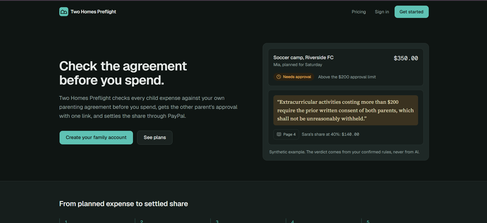
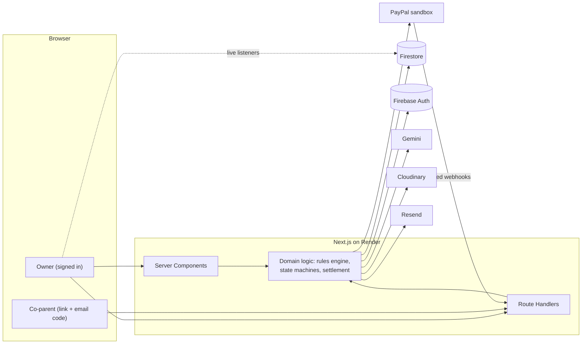

# Two Homes Preflight

**Check the agreement before you spend.**

[](LICENSE)
[](https://github.com/huzaifazahid1/two-homes-preflight/actions/workflows/ci.yml)


Two Homes Preflight is a co-parenting expense app. It reads the parenting agreement, tells a parent **before a purchase** whether the expense is covered (citing the exact clause and page), gets the other parent's approval through a no-install link, matches the receipt, and settles the other parent's share through **PayPal**.

Built for the **PayPal AI Hackathon 2026** during the official build window. All payments run in the PayPal sandbox, all money is USD, and all demo data is synthetic.



| | |
| --- | --- |
| Demo video |https://youtu.be/m4ofZTya-5A?si=uNxvEti99h2zZRyq |
| Live demo | https://two-homes-preflight.onrender.com |
| Architecture | [docs/architecture.md](docs/architecture.md) |
| API reference | [docs/api.md](docs/api.md) |
| Testing guide | [docs/testing.md](docs/testing.md) |
| Judges | Test logins and sandbox accounts are in the Devpost submission's testing instructions |

**Where to look, by judging area**

| Area | What to look at |
| --- | --- |
| PayPal | Orders v2 capture, Payouts, Subscriptions, verified webhooks, Log in with PayPal ([PayPal integration](#paypal-integration)) |
| AI | Gemini extraction whose quotes and numbers are verified by code before a parent can confirm them ([AI and sponsor tools](#ai-and-sponsor-tools)) |
| Engineering | One state-machine writer, idempotent PayPal calls, 12 checked invariants, unit, integration and E2E tests ([Architecture](#architecture), [Testing](#testing)) |
| AG Grid | The ledger: custom renderers, filters, selection export, pinned totals, themed light and dark ([AG Grid](#ag-grid)) |

## Contents

- [The problem](#the-problem)
- [How it works](#how-it-works)
- [Features](#features)
- [Tech stack](#tech-stack)
- [PayPal integration](#paypal-integration)
- [AI and sponsor tools](#ai-and-sponsor-tools)
- [Architecture](#architecture)
- [Run it locally](#run-it-locally)
- [Demo walkthrough](#demo-walkthrough)
- [Testing](#testing)
- [Project structure](#project-structure)
- [Plans](#plans)
- [Limitations and production notes](#limitations-and-production-notes)
- [License](#license)

## The problem

Separated parents usually split a child's costs according to a written agreement. In practice, the agreement is often checked only after the money is spent. One parent buys something, the other says it was never agreed, receipts go missing, and money is chased by text message for weeks. The arguments are about the agreement, but the agreement is a PDF that is hard to check at the moment it matters.

Two Homes Preflight moves the check to **before** the purchase and keeps every step (rule, approval, receipt, payment) tied to the sentence in the agreement that justifies it.

**Evidence we built on**

| Finding | Source |
| --- | --- |
| 13.9 million custodial parents in the US raise 22.2 million children whose other parent lives elsewhere; 37.3% had a legal child support agreement in 2022, down from 55.1% in 2003 | [US Census Bureau, P60-285 (2025)](https://www2.census.gov/library/publications/2025/demo/p60-285.pdf) |
| Court forms ask parents to consult before an expense is incurred, and set receipt deadlines | [Kansas Agreed Shared Parenting Plan](https://2jd.kscourts.gov/KSCourts/media/KsCourts/Trial%20court%20programs/App-VI-Agreed-shared-parenting-plan.pdf), [Ohio Form 20](https://www.supremecourt.ohio.gov/docs/JCS/CFC/DRForms/Form20.pdf) |
| Commercial legal AI tools produced incorrect or misgrounded answers in 17% to 33% of queries in one study, which is why our AI never decides | [Magesh et al., Stanford](https://law.stanford.edu/wp-content/uploads/2024/05/Legal_RAG_Hallucinations.pdf) |
| Family law professionals report expense requests being used to pressure a former partner, which is why the app has request limits | [Smyth et al., 2023](https://www.tandfonline.com/doi/abs/10.1080/09649069.2023.2206225) |

We did not run user interviews, so we make no claim about demand or willingness to pay.

## How it compares

Expense tracking, receipt scanning, custom splits, approvals after a request, and paying without installing an app already exist in co-parenting products (for example OurFamilyWizard, FairSplit, Blended and SupportPay). Checking spending against written policy before it happens, with the policy text cited, already exists in corporate expense tools (for example [Ramp](https://support.ramp.com/reviewing-transactions-from-ramp-cards)). We did not build those ideas first and do not claim to.

What we combine, and did not find in the public product pages we reviewed in November 2026: a **clause-and-page-cited eligibility check before the purchase**, built from the family's own agreement, with **the same approval carried through the receipt and the PayPal payout**. That is the result of our search, not proof that nobody else does it.

## How it works

```mermaid
flowchart LR
  A["Upload agreement"] --> B["Gemini extracts rules<br/>with verbatim quotes"]
  B --> C["Quotes verified against<br/>the text, parent confirms"]
  C --> D["Preflight: rules engine<br/>gives a clause-cited verdict"]
  D --> E["Co-parent approves<br/>via link + email code"]
  E --> F["Receipt to Cloudinary,<br/>read by Gemini, matched"]
  F --> G["Payment request<br/>with due date"]
  G --> H["Co-parent pays with PayPal<br/>(Orders v2 capture)"]
  H --> I["Platform pays the owed parent<br/>(Payouts), webhooks confirm"]
  I --> J["Ledger: every dollar<br/>traced to a clause"]
```



1. **Agreement.** The owner uploads the parenting agreement (PDF or pasted text). Gemini extracts expense rules, each with a verbatim quote and page number.
2. **Verification.** Every quote is checked against the stored page text, and every number in a rule must appear in its quote. A parent confirms each rule before it is used. AI never decides a verdict.
3. **Preflight.** Before buying, a parent describes the expense (or types a short note for AI quick add). A deterministic rules engine returns one verdict: Eligible, Needs approval, Missing evidence, Not covered, Late or Needs review, always citing the clause.
4. **Approval.** If approval is needed, the co-parent gets an email link, confirms a one-time code, sees the clause and their share, and approves, partly approves or declines. No app install or account is required.
5. **Receipt.** The receipt is stored privately on Cloudinary, read by Gemini, confirmed by the parent and matched against the approval (amount, date, store, duplicates).
6. **Claim.** A payment request goes out with a due date taken from the agreement. Outstanding and overdue amounts are tracked, with reminders.
7. **Settlement.** The paying parent pays with PayPal. The platform captures the payment and pays the owed parent through PayPal Payouts. Signed webhooks move the claim to Settled.
8. **Record.** The ledger shows every expense with its clause, verdict, approval and settlement, with filters, totals and CSV export.

## Features

**Agreement and AI**
- PDF or pasted-text upload, with scanned-PDF detection
- Gemini rule extraction (structured JSON, verbatim quotes, page numbers)
- Quote verification: exact match, match on another page, fuzzy match (similarity of at least 0.9), or not found. Unverified quotes cannot be confirmed
- A value-in-quote check: every percentage, dollar amount and day count must appear in its quote, which blocks invented numbers and prompt injection
- Rule review: confirm, edit (original kept), reject, or add by hand; source view with the quote highlighted
- Versioned rule sets (draft, active, superseded); expenses stay pinned to the version they were checked against
- Family details (parents, children) prefilled from the agreement

**Preflight and expenses**
- Deterministic rules engine with clause-cited verdicts and the split for each parent
- AI quick add from a short note ("Mia soccer camp $350 next Saturday")
- Live preflight while typing; duplicate expense check; full timeline per expense

**Approvals and links**
- Hashed, expiring link tokens with email one-time codes (rate limited, lockout after 5 wrong attempts)
- Approve, approve part, or decline; 14-day expiry, reminder after 3 days, 7-day block after a decline
- Co-parent can agree or disagree with each rule

**Receipts**
- Private Cloudinary storage with short-lived signed viewing URLs
- File type checked by magic bytes, duplicate detection by hash
- Gemini receipt reading (merchant, date, total, line items) with a manual fallback
- Match warnings: over the approved amount, bought before approval, store mismatch, late, possible duplicate

**Claims and money**
- Payment requests with a due date from the agreement, derived overdue status, manual and automatic reminders
- Mark received outside the app, waive, payer reports an outside payment, 7-day contest window, disputes
- In-app PayPal settlement with a fee breakdown shown before payment
- Reconcile with PayPal, payout retry after reconnecting, refund after a failed payout

**Product**
- Home dashboard with "needs your action" and totals, Money tab, live updates through Firestore listeners
- AG Grid ledger on desktop, card list on phones
- Free and Family plans with PayPal Subscriptions
- Light and dark themes, responsive from 375 px phones to desktop, axe accessibility checks (WCAG 2.1 A and AA rules) in the E2E suite

## Tech stack

| Layer | Technology | Used for |
| --- | --- | --- |
| Framework | Next.js 16 (App Router), React 19, TypeScript 6, Node 24 | Server Components for reads, Route Handlers for the API |
| UI | Tailwind CSS 4, shadcn/ui, Motion, Geist fonts, lucide icons | Design system, light/dark themes, micro-interactions |
| Tables | AG Grid Community 36 | Ledger |
| Auth and data | Firebase Authentication, Cloud Firestore | Sign-in, session cookies, data, real-time listeners |
| AI | Google Gemini (`@google/genai`) | Rule extraction, quick add, receipt reading |
| Payments | PayPal Orders v2, Payouts, Subscriptions, Webhooks, Log in with PayPal (`@paypal/paypal-server-sdk`, `@paypal/react-paypal-js`) | Settlement and billing |
| Files | Cloudinary | Private receipt storage |
| Email | Resend | Invites, one-time codes, approvals, reminders, settlement notices |
| Validation | zod | Every request, AI output and PayPal response |
| Testing | Vitest, Playwright, MSW, Firebase emulators, axe | Unit, integration, E2E, accessibility |
| CI and jobs | GitHub Actions | Test pipeline and a daily scheduled job |
| Hosting | Render web service | Live deployment and the PayPal webhook endpoint |

## PayPal integration

PayPal is central to the product: it moves the money, sells the subscription and identifies the parent who gets paid.

| PayPal product | How it is used | Code |
| --- | --- | --- |
| **Orders v2** | The server creates the order (amount always computed on the server: owed share plus any fee line) and captures it after the payer approves | [`src/lib/paypal/orders.ts`](src/lib/paypal/orders.ts), [`src/lib/checkout.ts`](src/lib/checkout.ts) |
| **Payouts** | After capture, the platform pays the owed parent exactly their share (`sender_batch_id = {expenseId}-{attempt}`) | [`src/lib/paypal/payouts.ts`](src/lib/paypal/payouts.ts), [`src/lib/settlement.ts`](src/lib/settlement.ts) |
| **Subscriptions** | Family plan: billing plan created by script, subscription verified on the server (`custom_id` = family, `plan_id` = our plan), cancel keeps access until the paid-through date | [`src/lib/paypal/subscriptions.ts`](src/lib/paypal/subscriptions.ts), [`scripts/setup-paypal-plans.ts`](scripts/setup-paypal-plans.ts) |
| **Webhooks** | Signature verified with PayPal on the raw body, deduplicated by event id, then dispatched for capture, refund, payout, subscription and dispute events | [`src/lib/paypal/webhooks.ts`](src/lib/paypal/webhooks.ts), [`src/lib/paypal/webhook-dispatch.ts`](src/lib/paypal/webhook-dispatch.ts) |
| **Log in with PayPal** | The receiving parent connects their PayPal account once (email fallback if unavailable) | [`src/lib/paypal/connect.ts`](src/lib/paypal/connect.ts) |
| **JS SDK Buttons** | Checkout on the payment link page and subscription on the billing page | [`src/components/payments`](src/components/payments) |

**Pass-through model.** The paying parent pays the platform's business account (Orders v2, no `payee`), and the platform pays the receiving parent (Payouts). This works with two personal PayPal accounts and no seller onboarding.

**Money safety.**
- Money is integer cents everywhere; no floating-point amounts.
- Every PayPal write carries a deterministic `PayPal-Request-Id` (`order-…`, `capture-…`, `payout-…`, `refund-…`), so double clicks, retries, webhooks racing the capture response and reconcile can never capture or pay twice.
- Every settlement change goes through one state machine function, `transition()`, inside a Firestore transaction with an audit log entry.
- A reconcile action and a daily job re-check anything still in flight with PayPal.
- An invariant checker (`npm run invariants`) verifies 12 money and state invariants against live data.

## AI and sponsor tools

### Gemini (runtime AI)

Gemini runs inside the product through `@google/genai`:

- **Agreement extraction:** structured JSON output at temperature 0 with verbatim quotes, verified by code before a parent can confirm them ([`src/lib/ai`](src/lib/ai), [`src/lib/quote-verify.ts`](src/lib/quote-verify.ts)).
- **Quick add:** turns a short note into a filled expense form.
- **Receipt reading:** merchant, date, total and line items from a photo or PDF; the parent confirms the values before matching.

AI never gives a verdict. Verdicts come from deterministic code ([`src/lib/rules-engine.ts`](src/lib/rules-engine.ts)). On failure there is one retry, then a visible error with manual entry. With `DEMO_MODE=true`, if Gemini fails on the bundled demo agreement only, a recorded extraction is used and labelled "Demo mode: cached extraction".

### AG Grid

The ledger (`/app/ledger`, desktop) is built on AG Grid Community ([`src/components/grid`](src/components/grid)):

- Custom cell renderers: a clause cell (short quote plus page chip that opens the agreement source with the quote highlighted), verdict, approval and settlement badges with derived overdue days, monospace money cells, action buttons
- Multi-column sorting, text, number and date column filters, a quick search box, and external filters (Overdue only, Owed to me, per child)
- Multi-row selection for CSV export of the selected rows
- Pinned bottom totals row (computed by the server), pinned first column, resizing, pagination
- `getRowId` set to the expense id, so live refreshes keep the selection
- Theme generated from the app's CSS design tokens, so it follows light and dark mode

Phones get a card list grouped by month instead of the grid.

### APIMatic

The PayPal Server SDK (`@paypal/paypal-server-sdk`) is generated by APIMatic, and the app uses it for Orders, refunds and Subscriptions. It was written in Claude Code with APIMatic's PayPal SDK context skills (in [`.claude/skills`](.claude/skills), `typescript-*`). The skills provided exact controller signatures, OAuth token provider setup, retry configuration and `ApiError` handling. Those details are used in [`src/lib/paypal/sdk.ts`](src/lib/paypal/sdk.ts), [`orders.ts`](src/lib/paypal/orders.ts), [`subscriptions.ts`](src/lib/paypal/subscriptions.ts) and [`scripts/setup-paypal-plans.ts`](scripts/setup-paypal-plans.ts). Payouts, webhook verification and catalog products use a typed `fetch` client ([`http.ts`](src/lib/paypal/http.ts)) because the SDK has no controllers for them.

### AI tools statement

| Tool | Used for |
| --- | --- |
| Google Gemini (`gemini-2.5-flash`, through `@google/genai`) | Runtime: agreement rule extraction, quick add, receipt reading |
| Claude Code (Anthropic) | Development: code and tests written from a written specification, reviewed and run by the author |
| APIMatic PayPal Server SDK context skills | Development: exact PayPal Server SDK usage for Orders, refunds and Subscriptions |

## Architecture



Key design decisions:

- **AI extracts, code decides.** Gemini proposes rules; code verifies them; a parent confirms them; a deterministic engine applies them.
- **One writer for state.** Approval and settlement states change only through `transition()` ([`src/lib/state/transition.ts`](src/lib/state/transition.ts)), which checks a transition table, writes a timeline event and an audit entry in one transaction.
- **Server-only writes.** Firestore security rules deny every client write; clients only read their own family's data through listeners.
- **Derived time states.** Overdue, expiry and plan entitlement are computed from timestamps, never stored as flags.
- **Thin handlers.** Every route goes through one `route()` wrapper (auth, zod validation, rate limits, error mapping, request id); business logic lives in `src/lib`.

Detailed sequence diagrams for links, PayPal connect, extraction, approvals and payments: [docs/architecture.md](docs/architecture.md). Every endpoint with its auth and errors: [docs/api.md](docs/api.md).

## Run it locally

Commands below work in Windows PowerShell, macOS and Linux. Every service has a free tier; no card is needed.

### Prerequisites

- Node.js 24 and npm 11
- Java 21 (only for the automated tests, which use the Firebase emulators)
- Accounts: [Firebase](https://console.firebase.google.com), [Google AI Studio](https://aistudio.google.com), [PayPal Developer](https://developer.paypal.com) (sandbox), [Cloudinary](https://cloudinary.com). [Resend](https://resend.com) is optional.
- [ngrok](https://ngrok.com) (optional) to receive PayPal webhooks on your machine

### 1. Install

```powershell
git clone https://github.com/huzaifazahid1/two-homes-preflight.git
cd two-homes-preflight
npm install
cp .env.example .env.local
```

On Windows PowerShell, `cp` is an alias of `Copy-Item`. Then fill in `.env.local` as described below. Every variable is validated at startup by [`src/lib/env.ts`](src/lib/env.ts), and a missing value produces a clear error naming the variable. The full list is in [`.env.example`](.env.example).

### 2. App secrets

`JOB_SECRET`, `LINK_SESSION_SECRET`, `OTP_PEPPER` and `DEV_SECRET` each need at least 32 random characters. Generate one per variable with:

```powershell
node -e "console.log(require('crypto').randomBytes(24).toString('hex'))"
```

Set `DEMO_MODE=true` to enable the `/onents/payments) |

**Pass-through model.** The paying parent pays the platform's business account (Orders v2, no `payee`), and the platform pays the receiving parent (Payouts). This works with two personal PayPal accounts and no seller onboarding.

**Money safety.**
- Money is integer cents everywhere; no floating-point amounts.
- Every PayPal write carries a deterministic `PayPal-Request-Id` (`order-…`, `capture-…`, `payout-…`, `refund-…`), so double clicks, retries, webhooks racing the capture response and reconcile can never capture or pay twice.
- Every settlement change goes through one state machine function, `transition()`, inside a Firestore transaction with an audit log entry.
- A reconcile action and a daily job re-check anything still in flight with PayPal.
- An invariant checker (`npm run invariants`) verifies 12 money and state invariants against live data.

## AI and sponsor tools

### Gemini (runtime AI)

Gemini runs inside the product through `@google/genai`:

- **Agreement extraction:** structured JSON output at temperature 0 with verbatim quotes, verified by code before a parent can confirm them ([`src/lib/ai`](src/lib/ai), [`src/lib/quote-verify.ts`](src/lib/quote-verify.ts)).
- **Quick add:** turns a short note into a filled expense form.
- **Receipt reading:** merchant, date, total and line items from a photo or PDF; the parent confirms the values before matching.

AI never gives a verdict. Verdicts come from deterministic code ([`src/lib/rules-engine.ts`](src/lib/rules-engine.ts)). On failure there is one retry, then a visible error with manual entry. With `DEMO_MODE=true`, if Gemini fails on the bundled demo agreement only, a recorded extraction is used and labelled "Demo mode: cached extraction".

### AG Grid

The ledger (`/app/ledger`, desktop) is built on AG Grid Community ([`src/components/grid`](src/components/grid)):

- Custom cell renderers: a clause cell (short quote plus page chip that opens the agreement source with the quote highlighted), verdict, approval and settlement badges with derived overdue days, monospace money cells, action buttons
- Multi-column sorting, text, number and date column filters, a quick search box, and external filters (Overdue only, Owed to me, per child)
- Multi-row selection for CSV export of the selected rows
- Pinned bottom totals row (computed by the server), pinned first column, resizing, pagination
- `getRowId` set to the expense id, so live refreshes keep the selection
- Theme generated from the app's CSS design tokens, so it follows light and dark mode

Phones get a card list grouped by month instead of the grid.

### APIMatic

The PayPal Server SDK (`@paypal/paypal-server-sdk`) is generated by APIMatic, and the app uses it for Orders, refunds and Subscriptions. It was written in Claude Code with APIMatic's PayPal SDK context skills (in [`.claude/skills`](.claude/skills), `typescript-*`). The skills provided exact controller signatures, OAuth token provider setup, retry configuration and `ApiError` handling. Those details are used in [`src/lib/paypal/sdk.ts`](src/lib/paypal/sdk.ts), [`orders.ts`](src/lib/paypal/orders.ts), [`subscriptions.ts`](src/lib/paypal/subscriptions.ts) and [`scripts/setup-paypal-plans.ts`](scripts/setup-paypal-plans.ts). Payouts, webhook verification and catalog products use a typed `fetch` client ([`http.ts`](src/lib/paypal/http.ts)) because the SDK has no controllers for them.

### Claude Code (development)

The project was built with Claude Code (Anthropic) working from a written specification, with project rules in [`CLAUDE.md`](CLAUDE.md).

## Architecture


Key design decisions:

- **AI extracts, code decides.** Gemini proposes rules; code verifies them; a parent confirms them; a deterministic engine applies them.
- **One writer for state.** Approval and settlement states change only through `transition()` ([`src/lib/state/transition.ts`](src/lib/state/transition.ts)), which checks a transition table, writes a timeline event and an audit entry in one transaction.
- **Server-only writes.** Firestore security rules deny every client write; clients only read their own family's data through listeners.
- **Derived time states.** Overdue, expiry and plan entitlement are computed from timestamps, never stored as flags.
- **Thin handlers.** Every route goes through one `route()` wrapper (auth, zod validation, rate limits, error mapping, request id); business logic lives in `src/lib`.

Detailed sequence diagrams for links, PayPal connect, extraction, approvals and payments: [docs/architecture.md](docs/architecture.md). Every endpoint with its auth and errors: [docs/api.md](docs/api.md).

## Run it locally

Commands below work in Windows PowerShell, macOS and Linux. Every service has a free tier; no card is needed.

### Prerequisites

- Node.js 24 and npm 11
- Java 21 (only for the automated tests, which use the Firebase emulators)
- Accounts: [Firebase](https://console.firebase.google.com), [Google AI Studio](https://aistudio.google.com), [PayPal Developer](https://developer.paypal.com) (sandbox), [Cloudinary](https://cloudinary.com). [Resend](https://resend.com) is optional.
- [ngrok](https://ngrok.com) (optional) to receive PayPal webhooks on your machine

### 1. Install

```powershell
git clone https://github.com/huzaifazahid1/two-homes-preflight.git
cd two-homes-preflight
npm install
cp .env.example .env.local
```

On Windows PowerShell, `cp` is an alias of `Copy-Item`. Then fill in `.env.local` as described below. Every variable is validated at startup by [`src/lib/env.ts`](src/lib/env.ts), and a missing value produces a clear error naming the variable. The full list is in [`.env.example`](.env.example).

### 2. App secrets

`JOB_SECRET`, `LINK_SESSION_SECRET`, `OTP_PEPPER` and `DEV_SECRET` each need at least 32 random characters. Generate one per variable with:

```powershell
node -e "console.log(require('crypto').randomBytes(24).toString('hex'))"
```

Set `DEMO_MODE=true` to enable the `/dev/demo` page (demo data seeding and the email outbox).

### 3. Firebase

1. Create a Firebase project. In **Authentication**, enable the **Email/Password** provider (Google is optional).
2. Create a **Cloud Firestore** database.
3. In Project settings, add a **Web app** and copy its config into the `NEXT_PUBLIC_FIREBASE_*` variables.
4. In Project settings, Service accounts, generate a private key. Copy `project_id`, `client_email` and `private_key` into `FIREBASE_PROJECT_ID`, `FIREBASE_CLIENT_EMAIL` and `FIREBASE_PRIVATE_KEY` (keep the `\n` sequences, in double quotes).
5. Deploy the security rules and indexes:

```powershell
npx firebase login
npx firebase use --add          # pick your project
npm run firebase:deploy-rules
```

### 4. Gemini

Create an API key in Google AI Studio and set `GEMINI_API_KEY`. Set `GEMINI_MODEL=gemini-2.5-flash` (the model verified with `npm run ai:check-extraction`).

### 5. PayPal sandbox

1. In the PayPal Developer Dashboard (Sandbox), open **Apps & Credentials** and create an app of type **Merchant** on your sandbox **business** account. This account is the platform that receives payments and sends payouts.
2. Copy the Client ID into `PAYPAL_CLIENT_ID` and `NEXT_PUBLIC_PAYPAL_CLIENT_ID`, and the secret into `PAYPAL_CLIENT_SECRET`.
3. Create the Family plan (catalog product plus billing plan) and copy the printed id into `PAYPAL_FAMILY_PLAN_ID` and `NEXT_PUBLIC_PAYPAL_FAMILY_PLAN_ID`:

   ```powershell
   npm run paypal:setup-plans
   ```

4. Webhooks: start a tunnel with `ngrok http 3000`. On the app, add a webhook for `https://<your-ngrok-domain>/api/webhooks/paypal` with the `PAYMENT.CAPTURE.*`, `PAYMENT.PAYOUTS-ITEM.*`, `PAYMENT.PAYOUTSBATCH.*`, `BILLING.SUBSCRIPTION.*`, `PAYMENT.SALE.COMPLETED`, `CHECKOUT.ORDER.APPROVED` and `CUSTOMER.DISPUTE.CREATED` events, and put its id in `PAYPAL_WEBHOOK_ID`. Without webhooks the app still works: the **Check with PayPal** button on an expense re-syncs from PayPal.
5. Optional: enable **Log in with PayPal** on the app with return URL `http://localhost:3000/connect/paypal/callback` (`PAYPAL_CONNECT_RETURN_URL`). Without it, parents connect by confirming their PayPal email.
6. Use the sandbox **personal** accounts from **Testing Tools, Sandbox Accounts** to pay and subscribe. The business account needs a sandbox balance for payouts.

### 6. Cloudinary

Copy the cloud name, API key and API secret into the `CLOUDINARY_*` variables. For PDF receipts, enable **Allow delivery of PDF and ZIP files** in Settings, Security.

### 7. Email

With `EMAIL_TRANSPORT=outbox` (the default), emails are not sent. They are stored in Firestore and shown, with working links and codes, on `/dev/demo`. To send real email, set `EMAIL_TRANSPORT=resend`, `RESEND_API_KEY`, and an `EMAIL_FROM` address on a domain verified in Resend.

### 8. Start

```powershell
npm run dev
```

Open http://localhost:3000.

### Deploying to Render

Create a Render web service from the repository with build command `npm install; npm run build` and start command `npm start`, on Node 24. Add the same variables as `.env.local`, with `APP_URL` and `PAYPAL_CONNECT_RETURN_URL` pointing at the Render URL, and register a second PayPal webhook for `https://<service>.onrender.com/api/webhooks/paypal`. The daily job ([`.github/workflows/daily-job.yml`](.github/workflows/daily-job.yml)) needs the repository secrets `APP_URL` and `JOB_SECRET`.

## Demo walkthrough

**Fast path.** With `DEMO_MODE=true`, open `/dev/demo`, enter `DEV_SECRET`, and seed the synthetic family: Alex (owner), Sara (co-parent, at an email you choose) and their child Mia. The page shows the owner's sign-in, a reset button, and the email outbox with every link and one-time code. The same is available from the command line:

```powershell
npm run seed -- --coparent=<email> --paypal=<sandbox receiver email>
npm run reset
```

**Full path.** Sign up, then paste [`fixtures/agreement/demo-agreement.md`](fixtures/agreement/demo-agreement.md) (or upload [`demo-agreement.pdf`](fixtures/agreement/demo-agreement.pdf)) during onboarding.

What to try, with expected results:

| Step | Expected result |
| --- | --- |
| Review the extracted rules | Each rule shows its quote and page; the vague "reasonable" clause is flagged; a quote not found in the text cannot be confirmed |
| Quick add "Mia soccer camp $350 next Saturday" | **Needs approval**, citing page 4 (approval above $200); the other parent owes $140 |
| Add a $120 dentist visit | **Eligible**, citing page 3 (50/50, no approval); the other parent owes $60 |
| Request approval, open the link from the outbox in a private window, enter the code | The co-parent sees the clause and their share and approves; the owner's screen updates live |
| Upload [`fixtures/receipts/bright-smile-dental.jpg`](fixtures/receipts) | Gemini reads $120.00; after confirming, the receipt matches the expense |
| Send the payment request and pay on the `/p/...` link with a sandbox personal account | Requires the Family plan (subscribe on `/app/billing` with a sandbox account first). Capture completes, a payout goes to the owed parent, and the claim moves to Settled when the webhook arrives |
| Open `/app/ledger` on desktop | The clause chip opens the source page; filter Overdue only or Owed to me; select rows and export them to CSV |

## Testing

| Command | What it runs |
| --- | --- |
| `npm run test:unit` | Vitest unit tests: rules engine, state machines, money, fees, quote verification, matching |
| `npm run test:integration` | Route handlers against the Firebase emulators, with PayPal, Gemini, Resend and Cloudinary replaced by local stubs (including a stateful PayPal fake that honours `PayPal-Request-Id`) |
| `npm test` | Unit, then integration |
| `npm run test:e2e:build`, then `npm run test:e2e` | Playwright journeys (onboarding, expenses, approvals, money) on a 375 px phone and a 1440 px desktop, plus an axe accessibility pass on every screen in light and dark themes. On Windows, set `$env:E2E_SKIP_BUILD="1"` before `npm run test:e2e` to reuse the build |
| `npm run test:sandbox` | Real end-to-end PayPal sandbox journey (manual, never in CI) |
| `npm run invariants` | Read-only check of 12 money and state invariants against the configured Firebase project |
| `npm run ai:check-extraction` | Runs the real Gemini model three times on the demo agreement |
| `npm run typecheck`, `npm run lint` | TypeScript and ESLint |

Current results: **178 unit tests and 221 integration tests** passing, E2E journeys passing on phone and desktop, and the real sandbox journey (subscribe, receipt read, claim, one-time code, capture, payout, webhooks) completed with **zero invariant violations**.

Automated tests read only the committed [`.env.test`](.env.test) and never touch a real Firebase project or a real external service. [GitHub Actions](.github/workflows/ci.yml) runs typecheck, lint, unit, integration, E2E and a client-bundle secret scan on every push and pull request, without any secrets. Details: [docs/testing.md](docs/testing.md).

## Project structure

```
src/
  app/
    (public)/            landing, pricing, legal, sign-in pages
    (app)/app/           dashboard, expenses, money, ledger, agreement, billing, settings
    onboarding/          setup wizard
    r/ a/ p/[token]/     invite, approval and payment link pages (no account needed)
    api/                 route handlers, including webhooks/paypal and jobs/daily
  components/            ui (shadcn), layout, domain components, grid (AG Grid)
  lib/
    rules-engine.ts      deterministic verdicts
    quote-verify.ts      AI quote verification
    state/               state machines and transition()
    paypal/              SDK client, orders, payouts, subscriptions, webhooks, connect
    ai/                  Gemini client, prompts, schemas, demo mode
    receipts/            Cloudinary upload and receipt matching
    settlement.ts        capture, payout and reconcile orchestration
  schemas/  types/       shared zod schemas and Firestore types
scripts/                 PayPal plan setup, demo seed/reset, invariant checker
fixtures/                synthetic agreement, receipts and recorded AI output
tests/                   unit, integration, api, e2e, sandbox, helpers
docs/                    architecture, API, testing, decisions, specifications
```

## Plans

Pricing is illustrative and runs in the PayPal sandbox; no real payments are taken. The parent who sets up the family chooses the plan, and the co-parent never pays for the app.

| | Free | Family ($7.99/month, 14-day trial) |
| --- | --- | --- |
| Agreement extraction | 1 agreement, 3 extraction runs | Unlimited runs and amendments |
| Preflight, approvals, receipts, claims, tracking | Yes | Yes |
| AI receipt reading | 10 per month | Unlimited |
| Settlement | Paid outside the app and confirmed in it | Paid in the app through PayPal |
| Processing fees | n/a | Covered up to a monthly volume of claims; above it, an estimated fee is shown to the payer before checkout |
| Automatic payment reminders | No | Yes |

## Limitations and production notes

- **Sandbox only.** Collecting from one parent and paying another (pass-through settlement) is regulated as money transmission in most US states. A production launch would need PayPal's approval for this model and a legal review.
- **Not legal advice.** The app shows what the agreement says, with quotes; it does not interpret the law.
- **Synthetic data.** The demo agreement, people and receipts are fictional.
- **Fee estimate.** The fee line shown above the covered volume is an estimate from configured rates; the actual PayPal fee is stored from each capture.
- **Refunds.** A refund is offered when a payout fails. After a payout succeeds there is no in-app refund; a PayPal dispute or reversal is recorded on the timeline and in the audit log.
- **Guest receivers.** A guest co-parent who is owed money receives settlement emails but cannot yet connect PayPal from the email link; in the demo, the owed parent is the account owner.

## License

[MIT](LICENSE). The agent skills in [`.claude/skills`](.claude/skills) are third-party content distributed under their own licenses.
