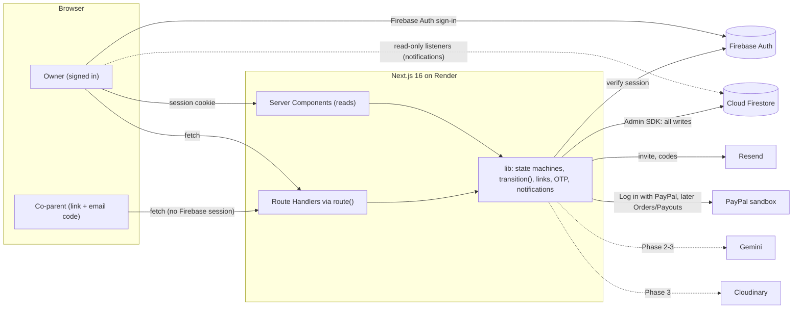
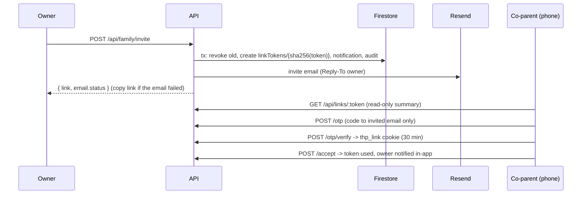
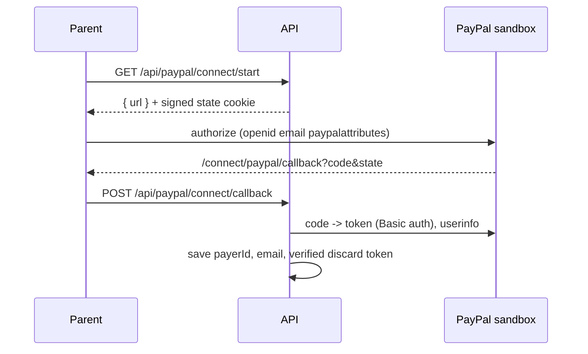

# Architecture

## System

- All writes go through the Admin SDK on the server. Firestore rules deny every client write and allow members to read only their own family's documents.
- `transition()` (`src/lib/state/transition.ts`) is the only writer of `approval.state` and `settlement.state`. It runs one transaction: read, apply time-derived rules, check the table row and guard, write with `version + 1`, append one `events` row, write the audit log, create notification docs.
- Time decisions go through `src/lib/clock.ts` and `src/lib/state/effective.ts`.

## Invite and link flow (Phase 1)

## Connect PayPal (Phase 1)

